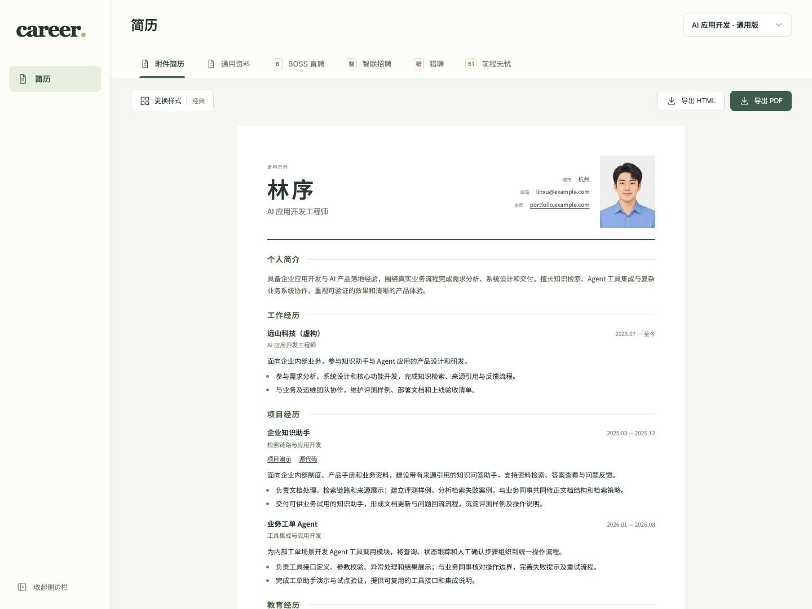
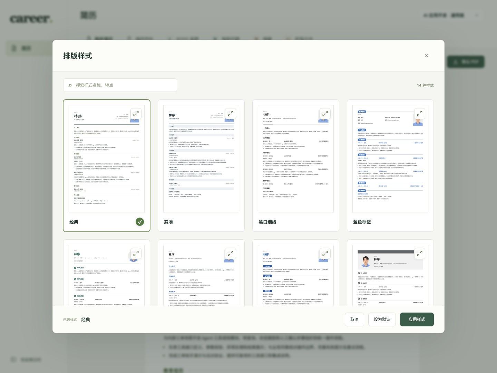

# career


**与 Agent 协作的个人求职工作台。**

从经历整理和简历生成出发，逐步连接岗位分析、求职进展跟踪与复盘。资料保存在你自己的目录，协作可以接着上次继续。

[开始使用](#开始使用把这段发给-agent) · [版本与能力](#版本与能力) · [路线图](docs/roadmap.md) · [参与开发](CONTRIBUTING.md) · [文档](docs/README.md)

## 从简历开始，贯穿一次求职

| 阶段 | 你和 Agent 一起完成的事 | 状态 |
| --- | --- | --- |
| 整理经历 | 从旧材料与对话提取事实，保留来源与待补问题 | 已实现 |
| 准备简历 | 维护母版、选择内容与排版，生成简历和平台填写稿 | 已实现 |
| 分析机会 | 收集岗位，结合目标与经历比较要求、证据和缺口 | 桌面预览版已提供 |
| 跟踪求职 | 关联岗位、所用简历、申请阶段、沟通记录与下一步 | 桌面预览版已提供 |
| 回顾调整 | 根据真实记录观察进展，复盘筛选和表达 | 规划中 |

[岗位工作区、协作 CLI 与看板](docs/opportunities.md)，以及[简历卡片库、统一内容包与网页编辑](docs/resume-packages.md)已随桌面预览版交付，npm 0.2.0 尚不包含。岗位、申请和分析沿用同一套个人资料。后续方向见[产品路线图](docs/roadmap.md)。

## 版本与能力

桌面版和 npm 包独立发布。下面区分已经交付的版本与当前源码；从源码构建的包即使仍标为 0.2.0，也不等于 npm 上的 0.2.0 产物。

| 能力 | npm 0.2.0 | 桌面 0.3.0-alpha.13 | 当前开发源码 |
| --- | --- | --- | --- |
| 经历整理、母版、14 款样式、HTML/PDF、平台填写稿 | 已提供 | 已提供 | 已实现 |
| 用户 Skills | 5 个 | 12 个 | 14 个 |
| 岗位看板、公司与岗位分析、面试记录与准备 | 未包含 | 已提供 | 已实现 |
| 简历卡片库、网页编辑、岗位关联与投递快照 | 未包含 | 已提供 | 已实现 |
| 根据 JD 与简历准备打招呼稿、查看和复制正文 | 未包含 | 未包含 | 已实现，使用外部 Agent |
| 个人资料阅读、多工作区与桌面启动器 | 未包含 | 已提供 | 已实现 |
| 本地 Git 与私人 GitHub 同步 | 手动保存、快进拉取与推送 | 安全合并、恢复与可选自动同步 | 同桌面版 |
| 企查查查询 | 未包含 | 自备 API Key，本机加密保存 | 桌面集成与环境变量 CLI |
| BOSS 搜索与采集 Skill | 未包含 | 已提供，需 Python 与本人浏览器登录 | 随包提供，首次使用按需准备 Python 与浏览器登录 |
| JD 需求研究与求职规划 Skill | 未包含 | 已提供 | 分析岗位共性、能力补足和简历表达，可独立使用 |
| 模型配置、JD 文字／图片解析与核对入库 | 未包含 | 已提供，自备模型 Key | 同桌面版 |
| 浏览器岗位收藏扩展 | 未包含 | 未随包分发 | 独立扩展 0.1.0，需手动加载 |

交付依据见 [npm 发布记录](docs/releases/0.2.0.md)和[桌面发布记录](docs/releases/desktop-0.3.0-alpha.13.md)。桌面版仍为未签名预览版；真实 GitHub 登录／上传全流程与扩展日常浏览器验收的边界见对应文档。招聘平台自动填表、自动投递、Word 导出和求职复盘指标仍未提供。

## 现在可以做什么

把旧简历、项目材料或一段口述交给 Agent。它按 Skills 引导补充信息、整理事实、维护母版，再调用 CLI 保存、校验和生成成果。



- **持续维护经历**：区分来源、事实、表达与待确认问题，新经历随时补充，中断后接着继续。
- **准备不同版本**：从同一套资料选材，按用途或用户提供的 JD 准备简历，保留对应版本。
- **选择样式与导出**：14 款排版，可选照片、分页预览、HTML/PDF；个人网页和项目链接在 PDF 中可点击。
- **准备平台填写稿**：BOSS 直聘、智联招聘、猎聘、前程无忧的主要经历字段可点击复制。技能、证书、语言等提供通用资料，由用户匹配平台选项。
- **保存与换机继续**：本地 Git 留存，可选连接自己的 GitHub 私人仓库；Agent 执行检查、保存与同步命令。

<details>
<summary>查看排版样式选择器</summary>



同一份内容可以切换样式、放大预览并设为默认；照片和链接按用户资料显示。截图使用合成内容，人物为虚构示例。

</details>

CLI 负责确定性的工具操作，写作与判断由用户选择的 Agent 完成。各安装入口提供的功能见上方版本表。

## 开始使用：把这段发给 Agent

需要看板、简历编辑和资料阅读，可先安装下方的[桌面预览版](#桌面版预览版)，创建工作区后复制软件中的指令交给 Agent。

使用 npm 0.2.0 的经历与简历流程，把下面这一句发给你的 Agent：

```text
请读取 https://raw.githubusercontent.com/heyjianhang/career/main/install.md，按指引帮我安装并初始化 career。
```

Agent 先和你确定保存位置，默认在该位置创建 `career-workspace` 文件夹。初始化完成后，它会引导你在 Agent 软件中打开这个文件夹，并给出一句新对话的开始指令。安装时不用填写姓名或简历。

新工作区的 `AGENTS.md` 接管后续流程：选择保存方式，再整理经历、维护母版和生成简历。详细引导集中在[安装指南](install.md)，[llms.txt](llms.txt)提供 Agent 文档导航；环境、换机和本地包试用见[安装说明](docs/installation.md)。

## Skills 与 CLI 怎么配合

| Skill | Agent 负责的工作 |
| --- | --- |
| [career-setup](.agents/skills/career-setup/SKILL.md) | 检查环境、初始化工作区，按已有状态衔接后续任务 |
| [career-git](.agents/skills/career-git/SKILL.md) | 引导账号与私人仓库准备、首次提交、日常保存、同步和换机恢复 |
| [career-intake](.agents/skills/career-intake/SKILL.md) | 盘点资料、维护阶段与范围，收集基本资料、教育与能力，路由深入整理 |
| [career-employment](.agents/skills/career-employment/SKILL.md) | 深入任职阶段、职责权限、协作与工作事件，建立可复用任职资产（桌面版／源码） |
| [career-project](.agents/skills/career-project/SKILL.md) | 深入项目背景、本人角色、关键决策、实施与复盘，留下详细资产（桌面版／源码） |
| [resume-master](.agents/skills/resume-master/SKILL.md) | 把事实整理成可读母版，保留个人贡献、来源与待补项 |
| [career-board](.agents/skills/career-board/SKILL.md) | 收集机会、查看全局、维护任务与资料，跨会话接手岗位（桌面版／源码） |
| [boss-zhipin-scraper](.agents/skills/boss-zhipin-scraper/SKILL.md) | 搜索 BOSS 岗位、读取 JD、标记新增机会，衔接看板收录（仅当前源码，尚未发布） |
| [目标公司发现（career-discovery）](.agents/skills/career-discovery/SKILL.md) | 根据实际工作与意向城市发现公司、核实招聘线索，选定 JD 后接入看板（当前源码，尚未发布） |
| [jd-research](.agents/skills/jd-research/SKILL.md) | 分析 JD 共性，结合真实经历制定求职与补足计划，提出简历修改建议（仅当前源码，尚未发布） |
| [career-company](.agents/skills/career-company/SKILL.md) | 独立研究公司业务、团队与经营信息，支持企查查与公开来源（当前源码） |
| [career-match](.agents/skills/career-match/SKILL.md) | 依据具体简历版本与 JD 做有证据的岗位匹配分析（当前源码） |
| [招聘开场白（career-outreach）](.agents/skills/career-outreach/SKILL.md) | 根据 JD 与投递简历写给 HR 的开场消息，留存版本依据并在岗位中查看、复制（当前源码） |
| [resume-tailor](.agents/skills/resume-tailor/SKILL.md) | 按用途选材，生成内容包和平台稿，调用 CLI 交付页面与文件 |


Skills 由桌面版或 npm 包安装到个人目录；npm 0.2.0 不包含 career-employment、career-project、career-board 、boss-zhipin-scraper 和 jd-research；已发布桌面 alpha.1 也不包含后两个 Skill。BOSS Skill 的 Python 依赖按需安装，使用方式见[安装说明](docs/installation.md#boss-岗位采集当前开发源码)。支持项目级 Skills 的客户端可以发现它们；其他 Agent 可从 `AGENTS.md` 按链接读取。自动发现方式取决于客户端，运行命令需要终端能力。

## 资料在哪里

```text
career-workspace/
├── AGENTS.md          # Agent 的协作入口
├── .agents/skills/    # 用户 Skills 及其参考资料
├── career.json        # 工作区配置、工具版本、同步选择
├── package.json       # 本目录使用的工具
├── package-lock.json  # 锁定依赖版本
├── context/           # progress 大阶段、state 当前一问、目标与反馈
├── resume/            # 来源、事实、母版、照片、简历内容包
└── build/             # 生成的 HTML、PDF 和构建快照
```

这个开源仓库存放工具源码与通用方法，个人目录保存用户资料。启用远程同步时，资料传到用户自己的私人仓库；生成文件、依赖和缓存默认不进入 Git。是否将材料发送给模型由所使用的 Agent 客户端及其设置决定。

GitHub 同步可跳过，之后仍可启用。npm 0.2.0 使用手动保存、快进拉取与推送，遇到未保存修改或历史分叉会停止。桌面预览版与当前源码支持先保存再安全合并，冲突时保留双方版本；自动同步需在本机显式开启，默认关闭。上传遵循用户授权，工具不随资料拉取自动升级。

## 桌面版（预览版）

桌面版支持创建／打开独立工作区，内置 CLI、八个 Skills 和 PDF 运行环境。创建后可复制指令交给 Agent，日常直接打开软件查看看板、简历与资料。

[下载 0.3.0-alpha.13](https://github.com/heyjianhang/career/releases/tag/desktop-v0.3.0-alpha.13)：Windows x64／ARM64、macOS Intel／Apple Silicon。新建工作区没有预置简历、岗位或示例资料。当前为未签名预览版，macOS 尚未公证，系统可能提示无法验证开发者；验收范围和 SHA-256 见[发布记录](docs/releases/desktop-0.3.0-alpha.13.md)。构建方法见[桌面版说明](docs/desktop.md)；上面的 npm 安装方式仍使用 0.2.0。

## 参与开发

欢迎改进 Skills、命令、中文排版及后续求职模块。先看[贡献指南](CONTRIBUTING.md)，了解[架构](docs/architecture.md)与[路线图](docs/roadmap.md)。统一的产品表达见[品牌定位](docs/brand.md)。

```bash
npm ci --ignore-scripts
npm test
npm run check:docs
npm run check:example
npm run test:package
```

CI 在 macOS、Windows、Linux / Node 22 上安装依赖、运行测试，并从实际安装包检查初始化和简历生成。[工作流](.github/workflows/check.yml)只做检查；npm 发布按维护者 [career-release](.agents/skills/career-release/SKILL.md) 另行执行。具体检查与发布流程见[开发说明](docs/development.md)。

## 许可证与致谢

采用 [MIT License](LICENSE)，允许使用、修改、分发和商用，分发时保留版权与许可声明。

字体、图标及依赖保留各自许可。见[素材说明](docs/assets.md)与[方法和设计参考](docs/references.md)。
