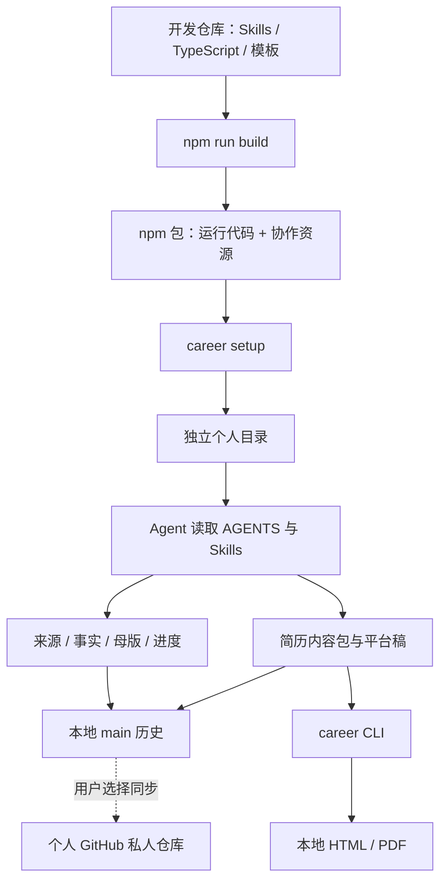

# 当前架构

career 定位为与 Agent 协作的个人求职工作台，当前由五个 Agent Skills 和一个 npm CLI 组成。Skills 提供协作方法，CLI 执行文件校验、版本保存、页面生成、导出和可选同步。模型能力来自用户选择的 Agent 客户端，CLI 不包含模型服务。

## 从源码到个人工作区

`setup` 初始化资料骨架，安装固定版本依赖和工作区指引，返回 `next_reads` 与 `next_action`。Agent 继续处理同步选择与资料收集。重复执行保留用户内容和自定义指引；不同工具版本不会被静默覆盖。

## 源码职责

| 路径 | 职责 |
| --- | --- |
| `.agents/skills/` | 五个 Skills 及各自的参考、事实／母版／平台模板 |
| `src/cli.ts` | 真实命令、参数解析和 JSON 结果 |
| `src/workspace/` | 安装、环境检查、受管指引、本地历史与 GitHub 同步 |
| `src/agent-api.ts` | 工作区盘点、摘要、内容包校验保存与冲突保护 |
| `src/presentation/` | 内容契约消费、模板渲染、分页、集合、本地服务与 PDF |
| `scripts/` | v2 资料工具、构建资源和合成演示 |
| `templates/workspace/` | 用户 AGENTS、Git 忽略规则等起步文件 |
| `templates/context/` | 个人协作上下文起步模板 |
| `schemas/` | 展示内容包的机器契约 |
| `examples/`、`tests/` | 合成资料与可重复检查 |

`npm run build` 生成 `dist/` 和 `resources/workspace/`。发布包采用 `package.json.files` 白名单，安装资源来自这个包，不依赖运行时克隆开发仓库。`.gitignore` 以 `gitignore.template` 打包，初始化时还原文件名。

## 两种协作入口

开发仓库根目录的 `AGENTS.md` 指向项目状态与开发规范；`templates/workspace/AGENTS.md` 安装到用户目录，指向安装、Git 版本与同步、访谈、母版和成品流程。两者不共享个人进度。

用户目录保留来源、事实、母版、候选与冻结版本、内容包和上下文。资料使用 [v2 Markdown 契约](data-model.md)，展示使用 [career-presentation/v1](presentation.md)。Agent 负责从事实选材和写作，CLI 不凭字段缺失生成经历。

## 页面与导出

模板注册表供 CLI、样式选择器和打印快照共同使用。同一内容包可切换样式；照片和链接可选。主预览和打印使用同一分页引擎，构建保存规则、内容与文件摘要，旧构建不随源码改动重写。

预览服务仅监听本机并提供当前构建页面。HTML 可单独导出；PDF 通过当前安装版本的 Playwright 浏览器生成。平台稿是可复制内容，不接管招聘网站账号或自动填表。

## 资料版本与同步

本地版本使用独立 `main` 仓库。远程连接限用户可写的 GitHub 私人仓库，使用 GitHub CLI 的登录状态；历史保存和上传是独立动作。拉取只允许快进，未保存修改或历史分叉时停止。新会话核对资料版本，不自动升级 npm 工具。

完整命令以 `npm run career -- --help --json` 为准。求职看板、平台登录／投递、Word 导出和 JSON v3 迁移尚未实现。后续岗位分析、申请跟踪与求职复盘的范围见[路线图](roadmap.md)。
