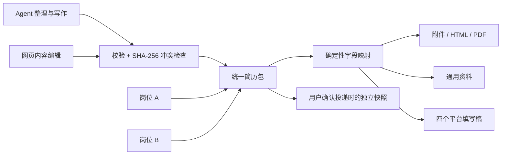

# 简历内容包与岗位关联

本模块已随桌面 0.3.0-alpha.1 预览版交付，当前源码继续维护。npm 0.2.0 使用旧展示内容包，不包含本文的简历卡片库、网页编辑和岗位关联。

新成品采用 `career-resume-package/v1`，位于 `<resume_dir>/presentations/<id>/package.json`。一个目录对应简历库中的一张卡片；网页与 Agent 共同维护它，正文只有 content 一份。照片可放同目录 assets，照片引用使用工作区相对路径及摘要。事实库／母版继续保留，用于事实核对和新版本选材。

## 唯一正文与生成规则

`content.profile` 保存姓名、方向、联系信息和照片；summary 保存简介；sections/items 保存有序经历。条目 kind 为 employment、project、education 或 other，日期、描述、职责、成果与链接分别保存。common.sections 统一保存技能、语言、证书等字段，同时生成通用资料与附件章节。未知字段保留，网页只改用户操作的字段。

字段规则以 resume platforms 为准。映射层按规则拆分／合并正文，专用字段不存在时将项目角色、公司、职责、成果及链接组合到正文；不调用模型，不自动改写或截断。超长返回 LENGTH_REVIEW。四平台只覆盖已核对的主要经历字段，不代表覆盖全部注册资料、选择器选项或提交校验。

来源变更返回 SOURCE_CHANGED，保留当前成品，Agent 核对后才决定是否更新。网页中的事实纠正不会自动反向修改母版，以免覆盖独立事实与其他方向；Agent 下次接手读取最新包并按确认的事实更新来源层。纯成品表达调整直接留在包中。

## 两个编辑入口

- `resume create --title <名称> [--from <ID>]`：空白草稿或独立副本。
- `resume read --id <ID>`：完整原包、路径及摘要。
- `resume save --input <候选> --if-match <原摘要>`：校验后原子保存；旧字节进入同目录 .history。
- `resume relations --id <ID>`：当前使用它的岗位与实际投递记录。

网页“编辑内容”通过同一保存层写回。未修改页面自动读取 Agent 保存的新内容；未保存草稿遇到外部变化时阻止覆盖，提供草稿下载与重新读取。CLI 冲突也必须重新读取并合并，不盲目替换摘要。

普通 preview 为实时工作台，首页显示简历卡片；旧 `build`、`preview --build` 和 CLI export 继续读取不可变快照。已下载 HTML/PDF 不会跟随新内容变化。网页的 PDF 导出核对正在查看的包摘要，若已更新要求先刷新。

实时工作台的“应用样式”保存当前简历 ID 的选择到 career.json 的 `presentation.resume_themes`，详情、首页缩略图与后续构建使用同一选择；不修改简历正文及更新时间，兼容原版包。“设为默认”单独维护 `presentation.default_theme`。新构建优先级为显式 `--theme`、这份简历已应用的样式、工作区默认、classic。取消默认不清除各简历已应用的样式；已有构建与离线导出保持各自快照。

## 简历卡片

卡片常规宽度为 280px，窄窗口按可用空间排列。预览按宽度缩放，展示第一页上半部分，裁去下半部分并沿用卡片自身边框，避免整张纸缩得过小。名称单独放在一行，下一行显示样式、实际页数和更新时间。页数来自当前完整内容与样式的分页结果，加载或预览失败时不猜测页数；正文或样式变化后重新计算。长名称省略显示，可悬停查看完整名称。

点击预览或名称打开简历；悬停、键盘聚焦或触屏时显示“编辑”和更多操作。更多菜单支持方向键、Escape 与 Tab，包含“另存一份”和“导出 PDF”；卡片导出使用当前简历的样式与内容摘要，遇到外部更新时提示刷新，成功后保留列表位置。旧展示包的编辑入口为“编辑副本”，先创建独立可编辑简历，保留原文件。

## 岗位引用与投递

card.md 的 resume 保存当前包的稳定 ID 与路径，不复制内容；一岗位一份当前选择，一份简历可以被多个岗位引用。当前关联没有固定内容摘要，因此跟随包的更新。show/context/overview 暴露关联，resume relations 提供反向查看。取消关联不删除简历。

`opportunity resume --id <岗位> --resume <简历|none> --if-match <卡片摘要>` 维护关联。需要岗位专用表达时先复制包，再关联。

用户确认实际投递后，`opportunity submit` 接收 resume_id、resume_sha256、submitted_at、channel、theme、confirmed:true，并要求卡片原摘要。工具将包、照片已内嵌的 HTML 和样式保存为唯一附件，再通过岗位事务将引用追加到 submissions。记录后编辑包、切换关联不会改变快照；快照被外部改动时摘要校验失败。

这个命令不自动投递、不自动推进阶段，也不证明平台已收到文件。必须确认当前内容与真实发送版本一致；不一致时另存实际文件并说明。快照附件是不可覆盖的新文件；如果保存快照后卡片发生并发修改，留下未关联附件供核对，不覆盖卡片、不误报投递记录成功。

## 旧资料兼容

career-presentation/v1 保持原有校验与导出。转为可编辑版必须另存，转换沿用附件正文，读取明确的日期字段，无法拆分的原表述保留；原包完整保存在新包 legacy.original，原文件不变。旧平台特有措辞在使用新生成稿前需要复核。现有 v2 Markdown 岗位版本与冻结记录不迁移、不覆盖。

网页编辑仅由本机服务提供，绑定 127.0.0.1；所有写入校验 Origin 与随机会话令牌。只提供受控 ID 和固定路由，不暴露整个工作区或执行上传文件。离线 HTML 只用于阅读、复制和导出。

## 可选内容与空栏目

当前源码统一过滤展示层的空栏目：缺省或空 items、全空白条目、空段落／要点、仅标签无值的通用资料、未填写的联系方式和求职方向不占位。只含标题、日期、说明或有效链接的条目仍保留；“无”“暂无”和数字 0 是实际内容，不自动删除。空链接可暂存在统一包草稿，但非空的非法网址仍拒绝保存。

14 种样式、卡片缩略图、预览、离线 HTML 与 PDF 共用此规则，编辑器及 package.json 不删草稿；历史冻结文件不回写。旧展示包允许 sections／items 为空数组；仍检查非空字段格式、来源和链接。空的平台稿显示“暂无可填写内容”。回归：node tests/resume-empty-browser.mjs，使用合成资料检查全部样式的空栏、分页与 PDF。
